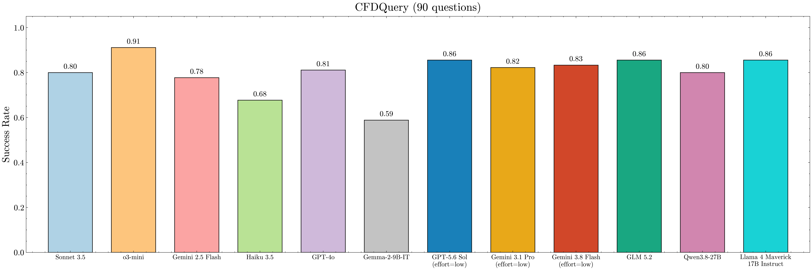
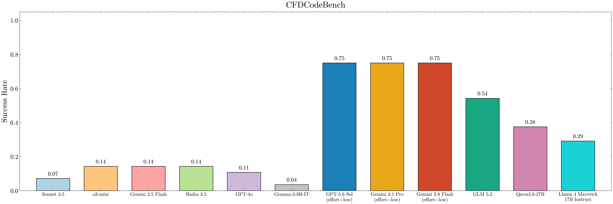
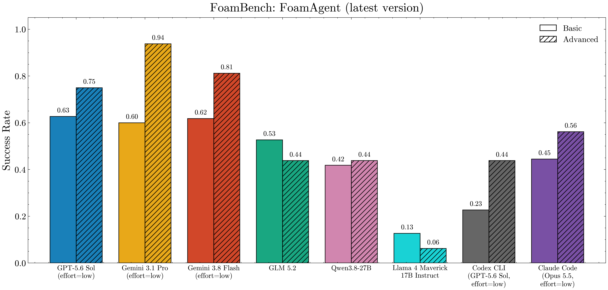
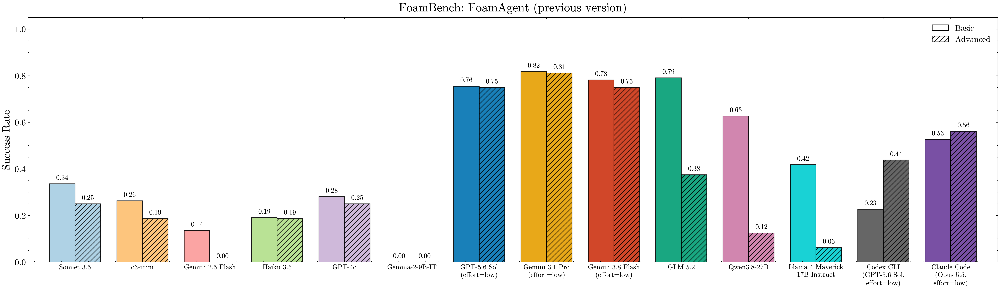

# CFDLLMBench V2

**CFDLLMBench** is a comprehensive benchmark suite designed to assess Large Language Models (LLMs) on key competencies relevant to computational fluid dynamics (CFD). It evaluates LLMs across three interconnected tasks:

- ✅ **CFDQuery**: Conceptual understanding through multiple-choice CFD questions.
- ✅ **CFDCodeBench**: Instruction-following ability to generate CFD code.
- ✅ **FoamBench**: End-to-end automation of OpenFOAM simulations from natural language.

> **What's new in V2:** we updated the prompts for some cases, evaluated newer LLMs, and evaluated the latest version of Foam-Agent.
> The latest (V2) datasets are included in this repository (see [Datasets](#-datasets)).

---

## 🔍 Motivation

While LLMs excel in general NLP, their ability to reason about scientific systems, generate structured physical code, and interface with domain-specific simulators like OpenFOAM remains underexplored.

**CFDLLMBench** bridges this gap by systematically measuring:
- Conceptual grasp of CFD principles (via QA),
- Structured code generation fidelity,
- Robustness of simulation execution and output.

---

## 🧱 Benchmark Components

### 📘 CFDQuery

- 90 graduate-level multiple-choice questions from CFD lectures.
- Covers numerical methods, turbulence modeling, and solver theory.
- LLMs select the correct option from four choices.

### 🔧 CFDCodeBench

- 24 natural language prompts describing CFD problems.
- Models must output executable CFD code (FDM, FVM, etc.).
- Evaluated on correctness, numerical stability, and output similarity.

### 🌀 FoamBench

- 110 Basic + 16 Advanced OpenFOAM simulation tasks.
- Benchmarks end-to-end tool use: case creation → execution → postprocessing.
- Assesses multi-step reasoning, domain adaptation, and recovery.

---

## 📂 Datasets

The latest (V2) datasets are in this repository:

- **CFDQuery**: [`CFDQuery/CFDQuery.json`](CFDQuery/CFDQuery.json)
- **CFDCodeBench**: [`CFDCodeBench/PDE_Benchmark/prompt/PDE_TASK_QUESTION_ONLY.json`](CFDCodeBench/PDE_Benchmark/prompt/PDE_TASK_QUESTION_ONLY.json) (task definitions) and [`CFDCodeBench/PDE_Benchmark/prompt/prompts.json`](CFDCodeBench/PDE_Benchmark/prompt/prompts.json) (prompts), with the reference solvers in [`CFDCodeBench/PDE_Benchmark/solution/`](CFDCodeBench/PDE_Benchmark/solution) and the reference answers in [`CFDCodeBench/PDE_Benchmark/results/solution/`](CFDCodeBench/PDE_Benchmark/results/solution)
- **FoamBench**: [`FoamBench/Dataset/FoamBench_basic.json`](FoamBench/Dataset/FoamBench_basic.json) and [`FoamBench/Dataset/FoamBench_advanced.json`](FoamBench/Dataset/FoamBench_advanced.json)

The datasets used in the original paper are on Kaggle: [CFDQuery](https://www.kaggle.com/datasets/nithinsekhar/cfdquery/data), [CFDCodeBench](https://www.kaggle.com/datasets/nithinsekhar/cfdcodebench/data), [FoamBench](https://www.kaggle.com/datasets/nithinsekhar/foambench/data).

---

## 🖼️ Benchmark Overview


---

## 📈 Main Results

### CFDQuery



### CFDCodeBench



### FoamBench

**Latest Foam-Agent version** (models evaluated in V2 and the Codex CLI / Claude Code coding agents):



**Previous Foam-Agent version** (models from the original paper and the models evaluated in V2, with the coding agents):



---

## 📄 License

This benchmark is open-source and released under license: BSD-3-Clause.

## Citation
If you use CFD-LLMBench in your research, please cite our paper:
```bibtex

@article{somasekharan2025cfdllmbench,
  title={{CFDLLMBench}: A Benchmark Suite for Evaluating Large Language Models in Computational Fluid Dynamics},
  author={Somasekharan, Nithin and Yue, Ling and Cao, Yadi and Li, Weichao and Emami, Patrick and Bhargav, Pochinapeddi Sai and Acharya, Anurag and Xie, Xingyu and Pan, Shaowu},
  journal={Journal of Data-centric Machine Learning Research},
  volume={3},
  number={13},
  pages={1--40},
  year={2026},
  month={2},
  publisher={JMLR.org},
  url={https://openreview.net/forum?id=kTcH1MnkjY}
}

```
